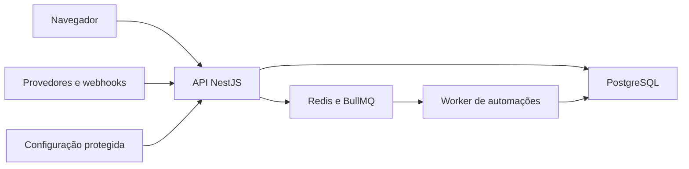

# Threat model — Essencial Clínicas

**Data:** 19/10/2026  
**Contexto confirmado:** SaaS multiempresa para dados clínicos, com possível exposição pública em produção. Esta revisão e seus testes ocorreram apenas localmente, com dados fictícios.  
**Escopo:** React/Vite, NestJS, Prisma/PostgreSQL, Redis/BullMQ e integrações representadas no código. Sem VPS, provedores reais, Uno ou serviços de IA externos.

## Executive summary

Os riscos mais relevantes são a manutenção da fronteira entre clínicas, o uso de consultas Prisma não escopadas em fluxos privilegiados, a exposição de tokens no armazenamento acessível ao JavaScript e a dependência de controles de implantação que não estão neste repositório. O backend revalida a sessão persistida em cada requisição, aplica contexto de clínica às consultas Prisma escopadas, separa 401 de 403 e possui regressões de isolamento. Não encontrei um caminho XSS direto nos componentes revisados. A aplicação ainda precisa de revisão do ambiente de implantação (TLS, cabeçalhos do frontend, gerenciamento de chaves, armazenamento distribuído dos limites) antes de ser considerada pronta para dados reais.

## Scope and assumptions

- Uso pretendido: recepção, equipe clínica e administração de clínicas; perfis Superadmin, administrador clínico, gerente e operador.
- Uma clínica não pode consultar dados de outra; usuários também são limitados às unidades permitidas.
- Considerado que a API poderá ser acessível pela internet em produção. Esse ambiente não foi inspecionado.
- Dados incluem identificação e contatos de pacientes, agenda, conversas, consentimentos, tarefas e dados de configuração.
- Integrações Meta/Evolution/Uno e IA foram revisadas por código; nenhuma chamada externa foi executada nesta tarefa.
- Não há evidência de RLS PostgreSQL no schema/migrations revisados; a separação é imposta principalmente pela camada de aplicação.
- Perguntas abertas que alterariam a avaliação: topologia e TLS do ambiente de produção; quantidade de réplicas da API; estratégia operacional de rotação/backup das chaves e do banco.

## System model

### Primary components

- Web React 19/Vite: autenticação, formulários e apresentação de dados recebidos da API.
- API NestJS: controladores, validação, autenticação JWT e autorização por clínica/unidade/papel.
- PostgreSQL via Prisma: dados duráveis; extensão `scoped` injeta `tenantId` e existe um cliente `unscoped` para tarefas de sistema e fluxos explicitamente filtrados.
- Redis/BullMQ: coordenação e fila de automações/outbox.
- Integrações: credenciais de provedores são armazenadas criptografadas; o modo testado foi dry-run local. Produção/serviços reais fora do escopo.

### Data flows and trust boundaries

- Navegador → API NestJS (HTTPS esperado na implantação; localmente HTTP): JSON, senha, access/refresh tokens e dados clínicos. JWT é validado, sessão/membership/usuário/tenant são relidos no banco, limites de requisição são aplicados e CORS usa `WEB_ORIGIN`.
- API → Prisma/PostgreSQL: consultas de negócio passam pelo contexto assíncrono e cliente `scoped`; entradas são filtradas por `tenantId`. Fluxos que usam `unscoped` precisam manter filtros explícitos no serviço.
- API/worker → Redis/BullMQ: identificadores de outbox e automação. O payload da fila não contém corpo de mensagem por padrão; o worker revalida estado persistido. No modo validado não há envio externo.
- Webhooks de provedores → API: eventos não confiáveis; os handlers validam assinatura/autenticidade e idempotência conforme os testes de API. A execução real com provedores não foi feita.
- Ambiente de implantação → aplicação: segredo JWT, chave de criptografia, URLs e flags vêm do ambiente. A proteção, rotação e acesso a esses segredos fora do código não foram confirmados.

### Diagram

## Assets and security objectives

| Ativo | Objetivo | Evidência |
|---|---|---|
| Dados de pacientes e conversas | Confidencialidade e integridade por clínica/unidade | `api/src/prisma/prisma.service.ts`, `api/src/security/tenant.guard.ts` |
| Sessões, senhas e MFA | Impedir tomada de conta e invalidar acessos revogados | `api/src/auth`, `api/src/security/tenant.guard.ts` |
| Papéis e escopos de unidade | Impedir ações acima do papel ou da unidade | `api/src/users`, `api/src/security` |
| Credenciais de integração e chaves | Não expor tokens de provedores; preservar capacidade de rotação | `api/src/security/secret-crypto.ts`, `api/src/messaging` |
| Agenda, consentimento, auditoria e automações | Preservar integridade, histórico e prevenção de efeitos duplicados | `api/src/appointments`, `api/src/automations`, `api/src/outbox` |
| PostgreSQL e Redis | Disponibilidade e consistência dos serviços | `api/src/prisma`, `api/src/queue`, `api/src/outbox` |
| Artefatos web | Evitar segredos no bundle e execução de conteúdo não confiável | `web/src`, `web/vite.config.ts` |

## Attacker model

### Capabilities

- Usuário autenticado tentando elevar papel, consultar outra clínica/unidade ou operar registro por ID.
- Atacante remoto tentando credenciais, abusar endpoints públicos/webhooks ou explorar conteúdo persistido.
- Operador interno com sessão válida tentando executar ação administrativa sem autorização.
- Conteúdo de paciente/conversa pode conter texto hostil que será exibido no navegador.

### Non-capabilities

- Não se presume acesso a segredos de produção, ao host, ao banco direto ou a conta de provedor.
- Não se presume controle de proxy/TLS/CDN. A configuração de implantação não foi verificada.
- Nenhuma ação real com Meta, Evolution, Uno, cobrança ou IA foi realizada.

## Threat enumeration and prioritization

| ID | Abuse path | Likelihood | Impact | Priority | Existing mitigation and evidence | Gap / recommendation |
|---|---|---|---|---|---|---|
| TM-1 | Usuário troca IDs em uma requisição e tenta atravessar clínica/unidade | Média: IDs podem ser manipulados; há muitos endpoints e relações. | Alta: exposição ou alteração de dados clínicos. | Alta | `TenantGuard` valida sessão e tenant; `TenantContextInterceptor` cria contexto; `PrismaService.scoped` injeta `tenantId`; E2E valida escopos. | Preservar testes negativos por endpoint e revisar operações em lote. Considerar RLS em desenho futuro, sem adicionar migration nesta tarefa. |
| TM-2 | Erro de serviço usa `PrismaService.unscoped` sem filtro de tenant e expõe dados de outra clínica | Média: o accessor está disponível no código e depende de disciplina por chamada. | Alta: leitura/alteração cross-tenant. | Alta | `unscoped` é usado em fluxos internos; a camada scoped rejeita modelos não mapeados; testes multiempresa cobrem rotas críticas. | Restringir usos de `unscoped`, encapsular operações de sistema em métodos estreitos e adicionar revisão automatizada dos novos usos. |
| TM-3 | XSS em conteúdo de conversa ou paciente lê token de sessão e opera como usuário | Baixa a média: React escapa texto por padrão e a busca direcionada não encontrou sinks HTML perigosos; novas dependências/recursos podem reabrir o caminho. | Alta: roubo de sessão e acesso a dados conforme permissões do usuário. | Média-alta | UI React; token access tem validade curta (15 min); Helmet é aplicado na API. Não foi encontrado `dangerouslySetInnerHTML`, `innerHTML` ou `document.write` em `web/src`. | Token em `sessionStorage` é legível por JavaScript. Avaliar BFF/cookie HttpOnly com proteção CSRF, CSP/headers também no host web e teste XSS de conteúdo persistido antes de dados reais. |
| TM-4 | Ataque de senha distribuído contorna limites locais ao atingir várias réplicas | Média se houver réplicas; a topologia não foi confirmada. | Média-alta: tomada de conta e indisponibilidade. | Média | Há `ThrottlerGuard` global e limites explícitos no login/refresh/recuperação. | Confirmar armazenamento compartilhado dos limites no ambiente multi-instância; aplicar limites distribuídos/WAF conforme arquitetura. |
| TM-5 | Vazamento/comprometimento da chave de criptografia expõe credenciais de integração salvas | Baixa sem acesso ao ambiente; impacto cresce se chave e banco forem acessíveis pelo mesmo operador. | Alta: acesso a canais de clínicas. | Alta | AES-256-GCM em `secret-crypto.ts`; testes verificam segredo não retornado em resposta. | Confirmar secret manager, permissões, backup separado, rotação e auditoria no ambiente. A rotação não foi testada. |
| TM-6 | Webhook falsificado cria mensagem/consentimento/estado de automação | Baixa quando assinatura/chave está correta; endpoint é público e recebe entrada hostil. | Alta: alteração de conversa, consentimento ou automação. | Média | Validação de assinatura, normalização e idempotência cobertas por testes em `tenant-isolation.db.e2e-spec.ts`. | Validar segredo e TLS no deploy e alertar falhas de assinatura/repetição. Não testar provedor real nesta tarefa. |
| TM-7 | Credencial de produção ou URL com segredo é embutida no bundle ou log | Baixa nos caminhos revisados; config de build e logs de implantação precisam ser confirmados. | Alta: tomada de conta ou canal. | Média | Credenciais de integrações criptografadas e API não retorna tokens; revisão direcionada não identificou sinks de conteúdo no frontend. | Verificar artefatos, source maps, logs e configuração final de produção antes de publicação. Não expor `VITE_*` secreto. |
| TM-8 | Abuso de fila esgota capacidade ou reprocessa ações após falha | Média: outbox e worker são caminhos de operação crítica. | Média-alta: atrasos, mensagens duplicadas ou indisponibilidade. | Média | PostgreSQL durável, BullMQ, idempotência, limites e reconciliação; dry-run exige modo explícito fora de produção. | Validar métricas, retenção, limite de concorrência e recuperação no ambiente de produção, sem testes de carga nesta tarefa. |

## Security review findings

1. **Alto — Cliente Prisma `unscoped` é uma fronteira sensível.** Evidência: getter público em `api/src/prisma/prisma.service.ts`; seu uso contorna a injeção automática de `tenantId`. Os serviços precisam incluir esse filtro em cada consulta. Não foi comprovada exploração; recomendação de contenção e revisão está em TM-2.
2. **Médio — Token access disponível em `sessionStorage`.** Evidência em `web/src/App.tsx` e camada de requisição. Isso amplia o impacto de um XSS; não encontrei sink HTML inseguro nos fontes revisados. Considerar cookie HttpOnly/BFF em arquitetura futura.
3. **Médio condicional — Throttling pode depender de memória local.** `ThrottlerModule`/`ThrottlerGuard` e limites por rota existem em `api/src/app.module.ts` e controladores. Confirmar um store compartilhado caso produção use múltiplas réplicas.
4. **Pendente de ambiente — TLS, headers do host Web, secret manager, backups e observabilidade.** Esses controles não podem ser confirmados por este repositório e não foram consultados em VPS/infra.

## Focus paths for manual security review

- `api/src/security/tenant.guard.ts` — validade de sessão, tenant suspenso e papel.
- `api/src/security/tenant-context.interceptor.ts` — fronteira entre request e escopo async.
- `api/src/prisma/prisma.service.ts` — políticas automáticas e cliente não escopado.
- `api/src/auth/` — login, refresh, recuperação, senha e MFA.
- `api/src/appointments/` — autorização por unidade, transações e concorrência.
- `api/src/automations/` e `api/src/outbox/` — idempotência, consentimento e efeitos assíncronos.
- `api/src/messaging/` e `api/src/security/secret-crypto.ts` — credenciais e webhooks.
- `api/src/ai/` — conteúdo não confiável, autorização de uso e envio a provedor configurado.
- `web/src/App.tsx` e `web/src/InboxConversationPanel.tsx` — sessão, conteúdo de conversa e superfície XSS.
- `api/prisma/schema.prisma` e `api/prisma/migrations/` — constraints e integridade multiempresa.

## Quality check

- Entradas HTTP, webhooks, autenticação, persistência, filas e integrações foram incluídas no modelo.
- Cada trust boundary aparece ao menos uma vez nos caminhos de abuso.
- Runtime foi separado de build/testes; execução de produção/infra não foi presumida.
- O cenário de multiempresa com dados clínicos e possível exposição pública foi confirmado pelo usuário.
- Assunções de implantação, TLS, réplicas, chaves e observabilidade continuam explicitamente abertas.

## Evidence anchors

- `api/src/security/tenant.guard.ts` — sessão persistida, status da clínica e autorização.
- `api/src/security/tenant-context.interceptor.ts` — escopo por requisição.
- `api/src/prisma/prisma.service.ts` — regra de tenant e acesso `unscoped`.
- `api/src/main.ts` — Helmet, CORS e listener.
- `api/src/security/secret-crypto.ts` — criptografia autenticada de segredo.
- `api/src/outbox/outbox-dispatch.service.ts` — política local dry-run e fila durável.
- `api/src/app.module.ts`, `api/src/auth/*.ts` — throttling global e por rota.
- `browser-tests/` e `api/test/tenant-isolation.db.e2e-spec.ts` — regressões locais e fixtures fictícias.
